# EPI 开发切片总览（架构大图 + 任务切片）

> 目标：给出 EPI 本体开发的完整切片视图，支持整体评估与逐切片风险分析。

## 1. 总体开发大图（EPI 本体，不是 FW 业务架构）

```mermaid
%%{init: {"flowchart": {"nodeSpacing": 26, "rankSpacing": 46, "padding": 2, "curve": "linear", "htmlLabels": false}, "themeVariables": {"fontSize": "13px"}}}%%
flowchart LR

  %% ── 图例（不参与数据流，配色见文件末尾样式块）──
  %% @legend Legend   声明式排除：转换工具据此跳过图例子图
  %% 判据只有一问：这条边搬的是内容，还是决策？
  subgraph Legend[图例 Legend]
    direction LR
    LGS[数据流] --> LGE[交付产物为主]
    LRS[控制流] -.-> LRE[驱动下游为主]
    LPU[待定] -.->| ？示例 | LPE[尚未裁定]
  end
  style Legend fill:#FFFFFF,stroke:#94A3B8,stroke-width:1.2px,stroke-dasharray:4 3

  subgraph Inputs[外部输入]
    IN_PRD[PRD]
    IN_BSP[BSP]
    IN_HW[HW 输入]
    IN_STD[STANDARDS]
    IN_TOOL[TOOLCHAIN/ENV]
  end

  subgraph Foundation[基础层]
    S01[S01 CLI入口]
    S02[S02 布局/模板]
    S03[S03 配置校验]
  end

  subgraph Schema[Schema/编译层]
    S04[S04 SD模板生成]
    S05[S05 parser]
    S06[S06 validator]
    S07[S07 compiler]
  end

  subgraph Knowledge[知识层]
    S08[S08 STANDARDS]
    S09[S09 PRD]
    S10[S10 REGS]
    S11[S11 artifact_graph]
  end

  subgraph Memory[记忆层]
    S12[S12 短记忆]
    S13[S13 长记忆]
    S14[S14 候选记忆]
    S15[S15 晋升规则]
    S16[S16 任务召回]
  end

  subgraph AgentCore[核心层]
    S17[S17 Context]
    S18[S18 Planner]
    S19[S19 State]
    S20[S20 LLM/Tools]
    S21[S21 Executor]
  end

  subgraph Verify[验证层]
    S22[S22 编译验证]
    S23[S23 静态验证]
    S24[S24 仿真验证]
    S25[S25 错误分类]
    S26[S26 重试策略]
  end

  subgraph Delivery[交付层]
    S27[S27 Traceability]
    S28[S28 Decision Log]
    S29[S29 Test Report]
    S30[S30 Quality Gates]
    S31[S31 CI矩阵]
  end

  %% 数据流（橙实线，箭头 -->）：这条边存在的理由是交付产物
  S01 -.->| 调用| S02
  S02 -->| config.yaml| S03
  S02 -->| 模板骨架| S04
  S04 -->| system-design.md| S05
  S05 -->| sections| S06
  S06 -->| schema| S07

  S02 -->| Docs布局| S08
  S02 -->| Docs布局| S09
  S02 -->| Docs布局| S10
  S09 -->| req节点| S11
  S10 -->| reg节点| S11

  S12 -->| 片段| S13
  S13 -->| 约束/决策| S14
  S08 -->| rules| S15
  S09 -->| req_index| S15
  S10 -->| reg_index| S15
  S11 -->| artifact_graph| S15
  S14 -->| candidate| S15
  S13 -->| long base| S16
  S15 -.->| 晋升后的规则| S16
  S12 -->| working| S17
  S16 -->| pack| S17


  S03 -->| 配置| S18
  S18 -->| 任务序列| S19
  S19 -.->| 调用 LLM| S20
  S19 -.->| 调度| S21
  S21 -->| 产物| S22
  S22 -->| 编译结果| S23
  S22 -->| 工件| S24
  S22 -->| 错误流| S25
  S23 -->| 静态告警| S25
  S24 -->| 仿真结果| S25
  S25 -->| 分类标签| S26

  S19 -->| 追踪规格| S27
  S13 -->| 决策| S28
  S22 -->| 编译结果| S29
  S23 -->| 静态结果| S29
  S24 -->| 仿真结果| S29
  S27 -->| 证据| S30
  S28 -->| 证据| S30
  S29 -->| 证据| S30
  S30 -.->| 判定门控| S31

  %% 运行时控制（控制流：蓝实线，箭头写 -.->）
  S17 -.->| 上一轮上下文回写| S12
  S15 -.->| ？晋升写入| S13
  S20 -->| 候选提名| S14
  S19 -.->| 当前task查询| S16
  S19 -->| 当前phase/task| S17
  S17 -->| 上下文输入| S18
  S26 -.->| 重试反馈| S19
  S17 -->| context pack| S20
  S20 -.->| 工具调用计划| S21
  S21 -->| 执行记录| S27
  S22 -->| 编译记录| S27
  S23 -->| 静态记录| S27
  S24 -->| 仿真记录| S27
  S19 -->| 状态转移事件| S28

  IN_TOOL -->| env| S03
  IN_PRD -->| 约束| S04
  IN_BSP -->| 边界| S04
  IN_HW -->| 硬件| S04
  IN_STD -->| 标准| S04
  IN_STD -->| source| S08
  IN_PRD -->| source| S09
  IN_HW -->| source| S10
  IN_PRD -->| req| S11
  IN_HW -->| reg| S11
  IN_PRD -->| task语义| S18
  IN_TOOL -->| 仿真环境| S24
  IN_TOOL -->| CI环境| S31

  %% 样式：颜色由 tools/apply_edge_style.py 依 graph-rules.json 生成，勿手改
  %% 类别只由箭头写法决定（--> 数据流，-.-> 控制流，-.->且标签含 ？ 待定），配色是输出不是输入
  linkStyle default stroke:#F97316,stroke-width:2.2px
  linkStyle 0 stroke:#F97316,stroke-width:2.2px,stroke-dasharray:0
  linkStyle 1 stroke:#2563EB,stroke-width:2.2px,stroke-dasharray:0
  linkStyle 2 stroke:#A855F7,stroke-width:3.2px,stroke-dasharray:6 3
  linkStyle 3 stroke:#2563EB,stroke-width:2.2px,stroke-dasharray:0
  linkStyle 4 stroke:#F97316,stroke-width:2.2px,stroke-dasharray:0
  linkStyle 5 stroke:#F97316,stroke-width:2.2px,stroke-dasharray:0
  linkStyle 6 stroke:#F97316,stroke-width:2.2px,stroke-dasharray:0
  linkStyle 7 stroke:#F97316,stroke-width:2.2px,stroke-dasharray:0
  linkStyle 8 stroke:#F97316,stroke-width:2.2px,stroke-dasharray:0
  linkStyle 9 stroke:#F97316,stroke-width:2.2px,stroke-dasharray:0
  linkStyle 10 stroke:#F97316,stroke-width:2.2px,stroke-dasharray:0
  linkStyle 11 stroke:#F97316,stroke-width:2.2px,stroke-dasharray:0
  linkStyle 12 stroke:#F97316,stroke-width:2.2px,stroke-dasharray:0
  linkStyle 13 stroke:#F97316,stroke-width:2.2px,stroke-dasharray:0
  linkStyle 14 stroke:#F97316,stroke-width:2.2px,stroke-dasharray:0
  linkStyle 15 stroke:#F97316,stroke-width:2.2px,stroke-dasharray:0
  linkStyle 16 stroke:#F97316,stroke-width:2.2px,stroke-dasharray:0
  linkStyle 17 stroke:#F97316,stroke-width:2.2px,stroke-dasharray:0
  linkStyle 18 stroke:#F97316,stroke-width:2.2px,stroke-dasharray:0
  linkStyle 19 stroke:#F97316,stroke-width:2.2px,stroke-dasharray:0
  linkStyle 20 stroke:#F97316,stroke-width:2.2px,stroke-dasharray:0
  linkStyle 21 stroke:#F97316,stroke-width:2.2px,stroke-dasharray:0
  linkStyle 22 stroke:#2563EB,stroke-width:2.2px,stroke-dasharray:0
  linkStyle 23 stroke:#F97316,stroke-width:2.2px,stroke-dasharray:0
  linkStyle 24 stroke:#F97316,stroke-width:2.2px,stroke-dasharray:0
  linkStyle 25 stroke:#F97316,stroke-width:2.2px,stroke-dasharray:0
  linkStyle 26 stroke:#F97316,stroke-width:2.2px,stroke-dasharray:0
  linkStyle 27 stroke:#2563EB,stroke-width:2.2px,stroke-dasharray:0
  linkStyle 28 stroke:#2563EB,stroke-width:2.2px,stroke-dasharray:0
  linkStyle 29 stroke:#F97316,stroke-width:2.2px,stroke-dasharray:0
  linkStyle 30 stroke:#F97316,stroke-width:2.2px,stroke-dasharray:0
  linkStyle 31 stroke:#F97316,stroke-width:2.2px,stroke-dasharray:0
  linkStyle 32 stroke:#F97316,stroke-width:2.2px,stroke-dasharray:0
  linkStyle 33 stroke:#F97316,stroke-width:2.2px,stroke-dasharray:0
  linkStyle 34 stroke:#F97316,stroke-width:2.2px,stroke-dasharray:0
  linkStyle 35 stroke:#F97316,stroke-width:2.2px,stroke-dasharray:0
  linkStyle 36 stroke:#F97316,stroke-width:2.2px,stroke-dasharray:0
  linkStyle 37 stroke:#F97316,stroke-width:2.2px,stroke-dasharray:0
  linkStyle 38 stroke:#F97316,stroke-width:2.2px,stroke-dasharray:0
  linkStyle 39 stroke:#F97316,stroke-width:2.2px,stroke-dasharray:0
  linkStyle 40 stroke:#F97316,stroke-width:2.2px,stroke-dasharray:0
  linkStyle 41 stroke:#F97316,stroke-width:2.2px,stroke-dasharray:0
  linkStyle 42 stroke:#F97316,stroke-width:2.2px,stroke-dasharray:0
  linkStyle 43 stroke:#F97316,stroke-width:2.2px,stroke-dasharray:0
  linkStyle 44 stroke:#2563EB,stroke-width:2.2px,stroke-dasharray:0
  linkStyle 45 stroke:#2563EB,stroke-width:2.2px,stroke-dasharray:0
  linkStyle 46 stroke:#A855F7,stroke-width:3.2px,stroke-dasharray:6 3
  linkStyle 47 stroke:#F97316,stroke-width:2.2px,stroke-dasharray:0
  linkStyle 48 stroke:#2563EB,stroke-width:2.2px,stroke-dasharray:0
  linkStyle 49 stroke:#F97316,stroke-width:2.2px,stroke-dasharray:0
  linkStyle 50 stroke:#F97316,stroke-width:2.2px,stroke-dasharray:0
  linkStyle 51 stroke:#2563EB,stroke-width:2.2px,stroke-dasharray:0
  linkStyle 52 stroke:#F97316,stroke-width:2.2px,stroke-dasharray:0
  linkStyle 53 stroke:#2563EB,stroke-width:2.2px,stroke-dasharray:0
  linkStyle 54 stroke:#F97316,stroke-width:2.2px,stroke-dasharray:0
  linkStyle 55 stroke:#F97316,stroke-width:2.2px,stroke-dasharray:0
  linkStyle 56 stroke:#F97316,stroke-width:2.2px,stroke-dasharray:0
  linkStyle 57 stroke:#F97316,stroke-width:2.2px,stroke-dasharray:0
  linkStyle 58 stroke:#F97316,stroke-width:2.2px,stroke-dasharray:0
  linkStyle 59 stroke:#F97316,stroke-width:2.2px,stroke-dasharray:0
  linkStyle 60 stroke:#F97316,stroke-width:2.2px,stroke-dasharray:0
  linkStyle 61 stroke:#F97316,stroke-width:2.2px,stroke-dasharray:0
  linkStyle 62 stroke:#F97316,stroke-width:2.2px,stroke-dasharray:0
  linkStyle 63 stroke:#F97316,stroke-width:2.2px,stroke-dasharray:0
  linkStyle 64 stroke:#F97316,stroke-width:2.2px,stroke-dasharray:0
  linkStyle 65 stroke:#F97316,stroke-width:2.2px,stroke-dasharray:0
  linkStyle 66 stroke:#F97316,stroke-width:2.2px,stroke-dasharray:0
  linkStyle 67 stroke:#F97316,stroke-width:2.2px,stroke-dasharray:0
  linkStyle 68 stroke:#F97316,stroke-width:2.2px,stroke-dasharray:0
  linkStyle 69 stroke:#F97316,stroke-width:2.2px,stroke-dasharray:0
  linkStyle 70 stroke:#F97316,stroke-width:2.2px,stroke-dasharray:0
  linkStyle 71 stroke:#F97316,stroke-width:2.2px,stroke-dasharray:0
```



### 1.1 边的图例

**判据只有一问：这条边搬的是内容，还是决策？**

**类别由箭头写法决定，颜色只是把它画出来**——两者矛盾时工具直接报错，不会静默画出另一张图。

| 箭头写法 | 颜色 | 类 | 含义 |
|---|---|---|---|
| `-->` | 橙 `#F97316` 实线 | 数据流 | **搬内容**：下游消费它，不改变"下一步做谁" |
| `-.->` | 蓝 `#2563EB` 实线 | 工作流 | **搬决策**：下游因它被触发或改变走向 |
| `-.->` 且标签以 `？` 开头 | 紫 `#A855F7` **虚线** | 待定 | 既是内容又是决策，**尚未裁定，勿据此推导开发顺序** |

> 两个类别都是实线，靠颜色区分；**虚线现在只有一个意思：待定**。以前虚线兼着"工作流"和"待定"两个含义，是误读来源。

当前 74 条边：数据流 57 / 工作流 11 / 待定 6。

### 1.2 开发顺序不在图里，由数据流推导

开发依赖是**派生量**，不是原始事实，所以不画、不手写，用脚本算：

```
python tools/derive_dev_order.py
```

公式：**开发顺序 = 数据流图缩点后的拓扑序**。工作流边不参与排序 —— 反馈回路本就该成环，把它们算进去会得出「S12–S26 必须同时开工」这种废话。

数据流图当前**只有一个环：`S17 → S18 → S19 → S17`**，即 agent 回路本身（上下文 → 任务序列 → 状态机 → 当前 phase 回写上下文）。这三片必须一起设计或先钉接口。该环已在 `tests/test_slices_overview.py` 里声明为唯一合法数据环；**出现新的数据环即测试失败**，因为那意味着有人把决策塞进了数据管道。

### 1.3 待定边（需架构裁定）

| 边 | 为什么两难 |
|---|---|
| `S17 ？上一轮上下文回写 S12` | 内容是数据，但它决定数据流图是否有环 |
| `S17 ？context pack S20` | 是内容，但决定模型看到什么 = 决定行为 |
| `S19 ？phase/task S20` | phase/task 是内容，调用 LLM 是控制，目前一条边扛两件事 |
| `S19 ？追踪 S27` | 追踪规格是内容，触发记录是控制 |
| `S15 ？promotion S16` | 晋升结果是内容，但改变后续召回范围 |
| `S30 ？判定 S31` | 判定结果既是产物又是闸门 |

裁定方式：**只改箭头和 `？`**——`-->` 数据流，`-.->` 工作流，`-.->` 且标签含 `？` 待定。改完跑 `tools/apply_edge_style.py`，配色自动跟随；手工改颜色无效，且会被一致性检查拦下。

### 1.4 工具链

图的可编辑表示只有 `.mmd`，其余全是派生产物。

| 命令 | 作用 |
|---|---|
| `python tools/apply_edge_style.py <mmd> <md>` | 按箭头规则重生成配色块，并把 `.mmd` 同步进 `.md`。幂等 |
| `python tools/gen_interactive_graph.py` | 生成可交互 HTML（`--check` 查过期，`--open` 直接打开） |
| `python tools/derive_dev_order.py` | 由数据流推导开发顺序，并列出数据环 |
| `python tools/sync_diagram_md.py <mmd> <md> --check` | 只检查 `.md` 内嵌图是否落后于 `.mmd` |
| `pytest tests/test_slices_overview.py tests/test_slices_graph.py` | 不变量守门 |

**语义规则集中在 `tools/graph-rules.json`**：颜色 ↔ 关系类别 ↔ 是否参与开发排序 ↔ 哪一列是节点功能描述。加一类关系或换描述列只改这个 JSON，代码不动。页面模板在 `tools/graph_template.html`。

改图流程：编辑 `.mmd` 的节点与箭头 → `apply_edge_style.py` → `gen_interactive_graph.py` → `pytest`。

### 1.5 交互图的聚焦语义

聚焦一个节点时，**只沿主关系（数据流）传递 N 跳**，构成以它为中心的 ego 网络；范围内的边全部显示，范围外一律不亮。工作流与待定边**不参与传递**，只在 ego 网络内部或与聚焦节点直连时出现。

原因：本图有一个 15 节点的强连通回路。若按“任意边可达”定义下游，`S26 → 重试反馈 → S19` 会把整个记忆子系统算成 S22 的下游，聚焦一个节点点亮大半张图 —— 那不是下游，是可达性爆炸。

节点说明框显示该片的**功能描述**（取自 WBS 表「目标产物」列）与验收标准；图例含义（箭头 ↔ 颜色）常驻右下角大图说明框，不随节点弹出。

---

## 2. 开发切片清单（WBS）

| Slice | 名称 | 目标产物 | 开发依赖 | 运行时依赖 | 验收标准（DoD） |
|---|---|---|---|---|---|
| S01 | CLI入口与命令模型 | `epi` 命令入口 | - | - | `epi /path`、`--schema-compile`、`--reset-schema-template` 可用 |
| S02 | 项目布局与模板生成 | Docs 目录树 + 模板文件 | S01 | - | 一键补齐目录；`--check-only` 正确报告 |
| S03 | 配置加载与校验 | `config` 模块 | S02, TOOLCHAIN/ENV 配置输入 | - | config 缺失/非法时给出明确错误 |
| S04 | SYSTEM-DESIGN 生成 | 完整 `system-design.md` | S02, PRD + BSP + HW(SCH/DATASHEET/REGS/PIN_MAP) + STANDARDS 输入约束 | - | 在模板基础上融合外部输入，生成可直接解析的完整设计MD |
| S05 | parser | section/kv/table/mermaid 解析 | S04（完整 `system-design.md`） | - | 仅读取 S04 输出MD并稳定解析固定结构 |
| S06 | validator | 严格规则校验 | S05 | - | section/表头不符即 fail |
| S07 | compiler | 编译输出 JSON | S06 | - | 输出 deterministic JSON |
| S08 | STANDARDS ingestion | `knowledge/rules.json` | S02, STANDARDS 文档输入 | - | 规则具备 source_id/source_path |
| S09 | PRD ingestion | `requirements_index.json` | S02, PRD 文档输入 | - | 需求具备 req_id/source |
| S10 | REGS ingestion | `register_index.json` | S02, HW REGS/DATASHEET 输入 | - | 寄存器条目可检索 |
| S11 | artifact_graph | `artifact_graph.json` | S09,S10, PRD + HW REGS 关联输入 | - | 可计算跨模块影响节点数 |
| S12 | 短记忆 | `working_memory.json` | - | S17（上一轮） | 每步刷新、体量受控 |
| S13 | 长记忆 | `long_memory.json` | S12 | S15（晋升写入） | decisions/constraints/traceability 三类齐全 |
| S14 | 候选记忆 | `candidate_memory.json` | S13 | S20（LLM提名输出） | 记录 LLM 提名候选 |
| S15 | 晋升规则引擎 | promotion 模块 | S08,S09,S10,S11,S14 | S14（候选输入） | 无白名单 source_id 不晋升 |
| S16 | 召回策略 | memory pack | S13,S15 | S19（当前task） | 按 task 返回最小记忆包 |
| S17 | ContextAssembler | 上下文组装器 | S12,S16 | S19（当前phase/task） | token 控量，按层注入 |
| S18 | TaskPlanner | 任务列表生成 | S03, PRD 输入 | S17（上下文输入） | PRD->任务有序可执行 |
| S19 | StateMachine | 主循环与状态流转 | S18 | S26（重试反馈） | phase/task/retry 行为可预测 |
| S20 | LLMClient+Tools | 模型与工具调用 | S19 | S17（上下文包） | provider 可替换 |
| S21 | Executor | 文件与动作执行 | S19 | S20（工具调用计划） | 写入动作可审计 |
| S22 | Compiler Verifier | 编译验证 | S21 | S21（执行产物输入） | fail 输出结构化错误 |
| S23 | Static Verifier | 静态分析 | S22 | S22（编译结果） | 规则告警可结构化 |
| S24 | Simulator Verifier | 仿真验证 | S22, TOOLCHAIN/ENV 运行输入 | S22（编译结果） | timeout/crash 可识别 |
| S25 | Error Classifier | 错误分类器 | S22,S23,S24 | S22,S23,S24（验证信号） | 分类准确映射恢复策略 |
| S26 | Retry Strategy | 重试策略引擎 | S25 | S25（分类结果） | 错误类型对应差异化重试 |
| S27 | Traceability 输出 | traceability 文档 | S19 | S21,S22,S23,S24（执行与验证记录） | req->code->test 全链路 |
| S28 | Decision Log 输出 | design_decisions 文档 | S13 | S19（状态转移事件） | 每个关键决策可追溯 |
| S29 | Test Report 输出 | test_report 文档 | S22,S23,S24 | S22,S23,S24（验证结果流） | 验证结果汇总完整 |
| S30 | Quality Gates | 门禁策略 | S27,S28,S29 | S29（实时门禁判定） | gate fail 阻断后续阶段 |
| S31 | CI矩阵 | Win/Linux CI | S30, TOOLCHAIN/ENV 矩阵输入 | S30（门禁结果） | 双平台流水线稳定 |

> 依赖说明：
> - **开发依赖**：实现该切片前必须完成的前置切片（对应图中**橙色实线**，即数据流）。
> - **运行时依赖**：执行阶段才产生的信息依赖（对应图中**蓝色实线**，即工作流）；若信息在执行前已知，则归入开发依赖。

---

## 3. 关键边界（防跑偏）

1. **FW Architecture ≠ EPI Development Architecture**
   - FW 架构图是业务输出。
   - 本文是 EPI 自身开发任务图。

2. **driver 初始化边界**
   - 不属于 `fw-architecture` 描述域。
   - 唯一来源：`Docs/ai-generation/register-init/*`。

3. **语义不做最终裁决**
   - LLM 可提名，不可直接晋升长记忆。
   - 最终由规则引擎按结构化证据判定。
