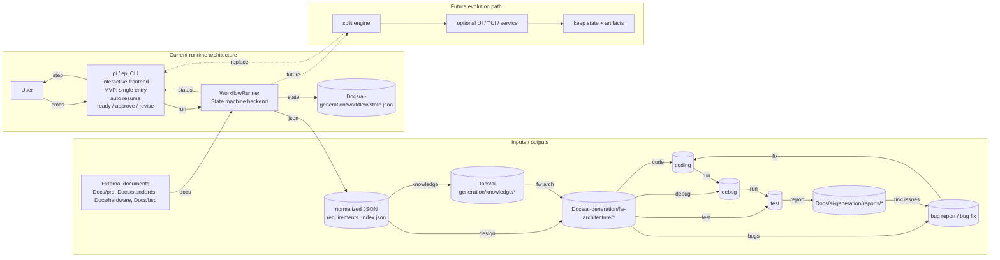

# EPI Workflow MVP Architecture

This diagram shows how the interactive `pi`/`epi` CLI cooperates with the resumable workflow engine.

## Responsibilities

- **pi / epi CLI**: renders prompts, shows status, accepts user input.
- **WorkflowRunner**: owns the phase machine, validates readiness, and advances only in order.
- **state.json**: shared resume point between runs.
- **Artifacts**: normalized knowledge, design outputs, and reports.

## Gate points

1. **External documents ready**: user types `ready`.
2. **Design approved**: user types `approve`.
3. **Design needs revision**: user types `revise` and workflow pauses.
