# Adonis 1.5 固件运行时架构（任务视图）

> 状态：**草案 / 待评审**。图源：`rtos-architecture.mmd`（本文件内嵌图由 `tools/sync_diagram_md.py` 同步，勿手改）
> 需求来源：`Docs/ai-generation/knowledge/requirements_index.json`（145 条）
> 硬件来源：IO-Mapping `Adonis-1P 1.5_IO-Mapping_V2.1` + SCH（MCU/Power/Sensor/USB/OLED）
> 执行模型判据与结论：见 `system-design/PROPOSAL-system-design-draft.md` §2

## 1. 运行时大图

```mermaid
flowchart TB

  %% ── 图例（不参与运行关系）──
  subgraph Legend[图例]
    direction LR
    LG1[实线 →] -->|调用 / 数据| LG2[上游被下游调用或产出被消费]
    LG3[虚线] -.->|IPC / 事件| LG4[任务间只经队列·事件组·信号量相遇]
    LG5[粗线] ==>|硬件路径| LG6[不经过软件调度器]
  end
  style Legend fill:#FFFFFF,stroke:#94A3B8,stroke-width:1.2px,stroke-dasharray:4 3

  subgraph HW[硬件与对端（确定性来源）]
    H_PWM[加热 PWM<br/>定时器驱动]
    H_ADC[ADC 序列 + DMA<br/>NTC / VOL / CUR]
    H_UART[UART RX<br/>BLE · USB]
    H_GPIO[GPIO 中断<br/>KEY · CAP_WKUP · USB_INT]
    H_CP[SS805EX<br/>OCP · OTP · MCU 复位]
    H_CIC[CIC BQ25622<br/>充电状态 · 360min 定时]
  end

  subgraph ISR[中断层（只搬数据与置标志）]
    I_ADC[ADC 完成 ISR]
    I_UART[UART RX ISR]
    I_TICK[SysTick 1ms]
    I_IO[GPIO ISR]
  end

  subgraph KERNEL[内核服务]
    K_SCHED[调度器<br/>优先级抢占]
    K_TIMER[软件定时器]
    K_IPC[队列 · 事件组 · 信号量]
    K_MEM[静态内存池<br/>禁止 malloc]
    K_WDG[活性令牌喂狗]
  end

  subgraph TASKS[任务层]
    T_SENS["T_SENS 采样/加热闭环<br/>prio1 · 1ms · 512B"]
    T_SAFE["T_SAFETY 安全监督<br/>prio2 · 10ms · 512B"]
    T_SESS["T_SESSION 会话状态机<br/>prio3 · 事件 · 1KB"]
    T_UI["T_UI 界面/动画<br/>prio4 · 20ms · 1.5KB"]
    T_BLE["T_BLE 协议与 GATT<br/>prio5 · 事件 · 2KB"]
    T_STOR["T_STORAGE 日志/分区<br/>prio6 · 分片 · 1KB"]
    T_UPD["T_UPDATE FOTA<br/>prio6 · 分片 · 2KB"]
    T_CLI["T_CLI USB 控制台<br/>prio7 · 事件 · 1KB"]
    T_PWR["T_POWER 电源/休眠<br/>prio7 · 事件 · 512B"]
  end

  subgraph SVC[服务与驱动]
    S_HEAT[heating_service<br/>档位·曲线·限幅]
    S_SAFE[interlock<br/>保护判定·失效策略]
    S_UI[ui]
    S_BLE[ble_profile]
    S_LOG[logging]
    S_UPD[update]
    S_PWR[power_service]
    S_CELL[power_cell<br/>充电·电量计]
  end

  subgraph HAL[HAL / 驱动]
    D_ADC[adc_sense]
    D_HEAT[heater]
    D_LCD[display]
    D_FLASH[storage]
    D_LBLE[link_ble]
    D_LUSB[link_usb_cli]
    D_HAP[haptics]
    D_IO[gpio_io]
    D_CORE[mcu_core<br/>时钟·复位·双核]
  end

  %% ── 硬件 → 中断 ──
  H_ADC ==> I_ADC
  H_UART ==> I_UART
  H_GPIO ==> I_IO
  H_PWM ==> H_ADC

  %% ── 中断 → 内核 ──
  I_ADC -.->|样本就绪| K_IPC
  I_UART -.->|帧到达| K_IPC
  I_TICK ==> K_SCHED
  I_IO -.->|事件| K_IPC

  %% ── 内核 → 任务 ──
  K_SCHED --> T_SENS
  K_SCHED --> T_SAFE
  K_SCHED --> T_UI
  K_TIMER -.->|周期 20ms| T_UI
  K_TIMER -.->|周期 10ms| T_SAFE
  K_IPC -.-> T_SESS
  K_IPC -.-> T_BLE
  K_IPC -.-> T_STOR
  K_IPC -.-> T_UPD
  K_IPC -.-> T_CLI
  K_IPC -.-> T_PWR

  %% ── 任务 → 服务 ──
  T_SENS --> S_HEAT
  T_SAFE --> S_SAFE
  T_SESS --> S_HEAT
  T_SESS --> S_PWR
  T_UI --> S_UI
  T_BLE --> S_BLE
  T_STOR --> S_LOG
  T_UPD --> S_UPD
  T_PWR --> S_PWR
  T_PWR --> S_CELL

  %% ── 服务 → HAL ──
  S_HEAT --> D_HEAT
  S_HEAT --> D_ADC
  S_SAFE --> D_ADC
  S_UI --> D_LCD
  S_UI --> D_HAP
  S_BLE --> D_LBLE
  S_LOG --> D_FLASH
  S_UPD --> D_FLASH
  S_PWR --> D_CORE
  S_CELL --> D_ADC

  %% ── HAL → 硬件 ──
  D_HEAT --> H_PWM
  D_ADC --> H_ADC
  D_LBLE --> H_UART
  D_LUSB --> H_UART
  D_IO --> H_GPIO

  %% ── 不经软件的安全路径 ──
  H_CP ==>|过流/过热直接断开| H_PWM
  H_CP ==>|CY_NRES| D_CORE
  H_CIC -.->|充电事件| I_IO

  %% ── 活性 ──
  T_SENS --> K_WDG
  T_SAFE --> K_WDG
  T_UI --> K_WDG
  T_BLE --> K_WDG
  K_WDG --> D_CORE

  %% ── 配色：按职责分层 ──
  classDef hw fill:#0F172A,color:#E2E8F0,stroke:#475569
  classDef isr fill:#FEE2E2,color:#7F1D1D,stroke:#DC2626
  classDef kernel fill:#E0E7FF,color:#1E1B4B,stroke:#4F46E5
  classDef task fill:#DBEAFE,color:#1E3A8A,stroke:#2563EB
  classDef svc fill:#DCFCE7,color:#14532D,stroke:#16A34A
  classDef hal fill:#FEF3C7,color:#78350F,stroke:#D97706
  classDef safety fill:#FBCFE8,color:#831843,stroke:#DB2777

  class H_PWM,H_ADC,H_UART,H_GPIO,H_CIC hw
  class H_CP safety
  class I_ADC,I_UART,I_TICK,I_IO isr
  class K_SCHED,K_TIMER,K_IPC,K_MEM,K_WDG kernel
  class T_SENS,T_SAFE,T_SESS,T_UI,T_BLE,T_STOR,T_UPD,T_CLI,T_PWR task
  class S_HEAT,S_UI,S_BLE,S_LOG,S_UPD,S_PWR,S_CELL svc
  class S_SAFE safety
  class D_ADC,D_HEAT,D_LCD,D_FLASH,D_LBLE,D_LUSB,D_HAP,D_IO,D_CORE hal
```

## 2. 任务表

优先级数字小=高。**栈与周期是待测占位**，不是结论——标 ★ 的必须实测标定后才能进 `system-design.md`。

| 任务 | 优先级 | 触发 | 周期/超时 | 栈★ | 服务 | 关联模块 | 需求 |
|---|---|---|---|---|---|---|---|
| `T_SENS` | 1 | 定时器/ADC | 1 ms | 512 B | heating_service | MOD-002/004/013 | 加热 21 |
| `T_SAFETY` | 2 | 软件定时器 | 10 ms | 512 B | interlock | MOD-019/002 | R-091 R-027 R-092 |
| `T_SESS` | 3 | 事件（队列） | 事件 | 1 KB | heating/power | MOD-013/014 | R-130 R-135 R-124 |
| `T_UI` | 4 | 周期+事件 | 20 ms | 1.5 KB | ui | MOD-006/012/005 | UI 22 |
| `T_BLE` | 5 | 事件+超时 | 帧/超时 | 2 KB | ble_profile | MOD-009/011 | BLE 27 |
| `T_STOR` | 6 | 批量/分片 | 队列非空 | 1 KB | logging | MOD-007/015 | 日志 12 |
| `T_UPD` | 6 | 分片 | 分片预算 | 2 KB | update | MOD-016/007 | 升级 21 |
| `T_CLI` | 7 | 事件 | 帧 | 1 KB | factory/cli | MOD-010/018 | 4 |
| `T_PWR` | 7 | 事件 | 事件 | 512 B | power_service | MOD-014/008 | 电源 22 |

**为什么加热排最高但不是 ISR**：加热闭环是 **ms 级**（架构裁定），用系统 tick 驱动即可；
它排 prio 1 是为了不被 UI/BLE 拖慢控制周期，而不是因为需要亚毫秒响应。

## 3. 中断层（只搬数据与置标志）

| ISR | 来源 | 做的事 | 不许做的事 |
|---|---|---|---|
| `I_ADC` | ADC 序列完成 / DMA | 样本入环形缓冲、置事件位 | 任何计算、任何阻塞 |
| `I_UART` | BLE / USB RX | 帧入队、置事件位 | 解析、内存分配 |
| `I_TICK` | SysTick 1 ms | 时基、软件定时器、调度节拍 | — |
| `I_IO` | KEY / CAP_WKUP / USB_INT / CIC 事件 | 记时间戳、发事件 | 去抖（去抖在任务里做） |

**不经任何软件的路径**：`SS805EX` 的 OCP/OTP 直接断开加热驱动，并可经 `CY_NRES` 复位 MCU。
软件侧的限幅是**第二道**，不是第一道——所以软件保护失效不等于无保护，反之亦然。

## 4. IPC 与共享资源

| 对象 | 类型 | 生产者 | 消费者 | 深度/预算 |
|---|---|---|---|---|
| `Q_SAMPLE` | 环形缓冲 | `I_ADC` | `T_SENS` | 32 样本，满则覆盖最旧并计数 |
| `Q_BLE_RX` / `Q_BLE_TX` | 队列 | `I_UART` / `T_BLE` | `T_BLE` / `I_UART` | 8 帧 |
| `EV_SYS` | 事件组 | ISR / 各任务 | `T_SESS` `T_UI` `T_PWR` | 位掩码 |
| `Q_LOG` | 队列 | `T_SENS` `T_BLE` | `T_STOR` | 64 条，满则丢并计数★ |
| `Q_OTA` | 队列 | `T_BLE` | `T_UPD` | 分片块 |
| `M_FLASH` | 互斥量 | `T_STOR` `T_UPD` `T_CLI` | — | **持有期间不得跨越擦除块** |
| `SEM_WDG` | 活性令牌 | 各关键任务 | `T_SAFETY` | 见 §6 |

## 5. 模块 → 任务

| 任务 | 服务/驱动模块 | 可主机测试？ |
|---|---|---|
| `T_SENS` | MOD-002 adc_sense · MOD-004 heater · MOD-013 heating_service | ✅ 纯函数（采样→控制量） |
| `T_SAFETY` | MOD-019 interlock | ✅ 判定逻辑纯函数 |
| `T_SESS` | MOD-013 · MOD-014 | ✅ 状态机 |
| `T_UI` | MOD-012 ui · MOD-006 display | ✅ 状态机（渲染打桩） |
| `T_BLE` | MOD-011 ble_profile · MOD-009 link_ble | ✅ 协议编解码 |
| `T_STOR` | MOD-015 logging · MOD-007 storage | ✅ 分区/序列化 |
| `T_UPD` | MOD-016 update | ✅ 镜像校验/状态机 |
| `T_CLI` | MOD-010 link_usb_cli · MOD-018 factory | ✅ 命令解析 |
| `T_PWR` | MOD-014 power_service · MOD-008 power_cell | ✅ 策略逻辑 |

**架构约束**：业务逻辑与内核调用分离（任务体只做"取事件→调纯函数→发命令"），
这样 `tests/**/*_test.c` + gcc + `assert` 能直接测业务，**不需要 OS 移植层**。
这条不是风格偏好：它是本项目唯一能在主机上跑起来的可验证性来源。

## 6. 调度不变量（违反任一条即视为设计缺陷）

1. **禁止 `malloc`**：全部静态池分配，内存峰值可算
2. **临界区预算**：任何临界区不得包含 flash 擦写、I²C 事务、UART 等待★（数值待实测）
3. **优先级天花板**：`M_FLASH` 用互斥量继承，禁止靠关中断实现"锁"
4. **活性令牌喂狗**：`T_SENS` `T_SAFETY` `T_UI` `T_BLE` 各占一位，**全部按期到达才喂**；
   在 `main`/idle 里无条件喂狗等于在 R-091 描述的场景下关掉看门狗
5. **加热任务必须有活性令牌**：加热跑在 tick 上，调度器一停加热就失控（这是"加热进任务"的直接代价）
6. **长任务分片**：`T_UPD` / `T_STOR` 单次持有 CPU 不得超过分片预算，
   否则 R-053（传输期间设备必须完全可用）无法满足
7. **ISR 不调度、不分配、不计算**

## 7. 待定量（缺输入，写下来才是诚实）

| 待定 | 缺什么 | 影响 |
|---|---|---|
| 加热闭环周期与允许抖动 | `registers/` `datasheet/` | 决定 `T_SENS` 周期与栈 |
| 各任务栈大小 | 上板测量（高水位） | 表中 ★ 全是占位 |
| BLE 帧率与缓冲深度 | SS805EX 侧协议 | 决定 `Q_BLE_*` 深度 |
| flash 擦写最坏时长 | 芯片手册 | 决定分片预算与 `M_FLASH` 预算 |
| 双核分工（CM4 / CM0+） | 架构裁定 | 可能把 `T_SAFETY` 挪到 CM0+ |

## 8. 与 EPI 侧的对应

- 本图的模块 id 与 `MODULE_DESIGN_TABLE` 对齐；搬进 `system-design.md` 后 S04 覆盖检查才会变绿
- 任务表与 `TASK_TABLE`（`task_id`/`period_ms`/`priority`/`stack_bytes`/`entry_fn`/`req_ids`）字段一一对应
- 图与 `.mmd` 的一致性由 `sync_diagram_md.py --check` 保证，不会与文档漂移
